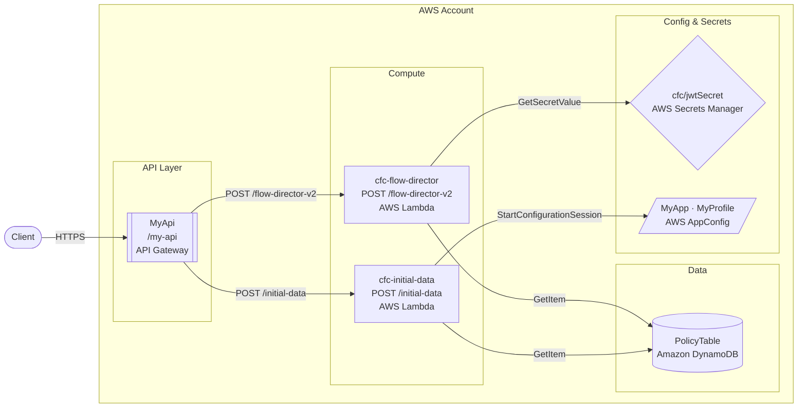

# Generate Architecture Command

Scans the repository infrastructure config and Lambda handler files to produce architecture diagrams in both draw.io (`.drawio`) and Mermaid (`.md`) formats, stored in `docs/`.

Pass `--update` to regenerate existing diagram files in place without prompting.

## Arguments

- `--update` (optional): Overwrite existing `docs/architecture.md` and `docs/architecture.drawio` without prompting.

## Workflow

### Step 1: Read the Repository Shape

Collect infrastructure context before generating any diagrams.

**Infrastructure config** — use the same discovery priority as `/generate-openapi-spec`:
1. `serverless.yml` / `serverless.yaml` — `functions`, `events.http`, `provider`, `environment`
2. CDK stacks (`*stack*.ts`, `*api*.ts`) — `RestApi`, `HttpApi`, `addResource`, `addMethod`
3. SAM / CloudFormation (`template.yaml`, `template.json`) — `AWS::ApiGateway::*`, `AWS::Serverless::*`, `AWS::Lambda::Function`
4. Any existing `openapi*.yaml` / `swagger*.json` — extract the `paths` block for route inventory

**Lambda inventory** — for each Lambda identified in the infrastructure config:
- Handler file path
- Function name and logical purpose (derive from the handler name, file path, and the first JSDoc comment or `// ` comment at the top of the file if present)
- HTTP method + path it is bound to (or "event-driven" if not HTTP)

**Existing `docs/` directory** — list any `.drawio`, `.mermaid`, or `.md` diagram files already present so they can be updated rather than duplicated.

### Step 2: Discover AWS Resources

Before generating any diagram, scan all infrastructure config files and Lambda handler source to build a complete inventory of every AWS resource the system touches. This inventory drives both diagram formats — do not guess or assume services; only include what is actually found.

**Scan infrastructure config** (`serverless.yml`, CDK stacks, SAM `template.yaml`) for:
- `AWS::ApiGateway::RestApi` / `HttpApi` / `AWS::Serverless::Api` → API Gateways
- `AWS::Lambda::Function` / `AWS::Serverless::Function` → Lambdas with their handler paths
- `AWS::DynamoDB::Table` → table names and key schema
- `AWS::SecretsManager::Secret` / `secretsmanager` references → secret names
- `AWS::AppConfig::Application` / `appconfig` references → AppConfig apps and profiles
- `AWS::S3::Bucket` → bucket names and purpose
- `AWS::SNS::Topic` / `AWS::SQS::Queue` → event bus topology
- `AWS::Events::Rule` (EventBridge) → event sources and targets
- `AWS::Cognito::UserPool` / authorizer references → auth layer
- `AWS::IAM::Role` only if it reveals a cross-service relationship (e.g. a role that grants Lambda access to a specific table)
- Environment variables that reference ARNs, table names, secret names, or endpoint URLs — these often reveal resources not declared in the same stack

**Scan each Lambda handler file** for `@aws-sdk/client-*` imports and SDK calls to catch any resources not declared in config:

| SDK import | Resource type |
|---|---|
| `@aws-sdk/client-dynamodb` / `lib-dynamodb` | DynamoDB |
| `@aws-sdk/client-secrets-manager` | Secrets Manager |
| `@aws-sdk/client-appconfig` / `client-appconfigdata` | AppConfig |
| `@aws-sdk/client-s3` | S3 |
| `@aws-sdk/client-sns` | SNS |
| `@aws-sdk/client-sqs` | SQS |
| `@aws-sdk/client-eventbridge` | EventBridge |
| `@aws-sdk/client-cognito-identity-provider` | Cognito |
| `@aws-sdk/client-ssm` | SSM Parameter Store |
| `axios` / `fetch` calls to non-AWS URLs | External API (label with the domain) |

For each SDK call, also extract the resource name/ARN from the call arguments (e.g. `TableName`, `SecretId`, `Application`) where determinable — use as the node label in the diagram.

Record the final inventory as:

```
Nodes:
  API Gateways:    [MyApi /my-api]
  Lambdas:         [cfc-flow-director, cfc-initial-data, ...]
  DynamoDB:        [PolicyTable, VehicleTable]
  Secrets Manager: [cfc/jwtSecret]
  AppConfig:       [MyApp / MyProfile]
  S3:              [policy-documents-bucket]
  SNS:             []
  SQS:             []
  External APIs:   [api.acme.com]
  Cognito:         [UserPool]

Edges (Lambda → resource):
  cfc-flow-director → PolicyTable
  cfc-flow-director → cfc/jwtSecret
  cfc-initial-data  → PolicyTable, VehicleTable, cfc/jwtSecret
  ...
```

### Step 3: Generate Mermaid Diagram (`docs/architecture.md`)

Use the AWS resource inventory from Step 2. Write a Mermaid `graph LR` (left-to-right) diagram using AWS-semantic node shapes and subgraph groupings.

**Node label format** — every node must show two or three lines of text so the diagram is self-explanatory without a legend:

| AWS Service | Line 1 | Line 2 | Line 3 (if applicable) |
|---|---|---|---|
| Client / browser | `Client` | — | — |
| API Gateway | full gateway name (e.g. `MyApi`) | base path (e.g. `/my-api`) | `API Gateway` |
| Lambda | full function name (e.g. `cfc-flow-director`) | HTTP method + path (e.g. `POST /flow-director-v2`) or `event-driven` | `AWS Lambda` |
| DynamoDB | table name (e.g. `PolicyTable`) | `Amazon DynamoDB` | — |
| Secrets Manager | secret name (e.g. `cfc/jwtSecret`) | `AWS Secrets Manager` | — |
| AppConfig | app + profile (e.g. `MyApp · MyProfile`) | `AWS AppConfig` | — |
| S3 | bucket name (e.g. `policy-documents`) | `Amazon S3` | — |
| SNS | topic name (e.g. `OrdersTopic`) | `Amazon SNS` | — |
| SQS | queue name (e.g. `ProcessingQueue`) | `Amazon SQS` | — |
| EventBridge | bus/rule name (e.g. `OrderBus`) | `Amazon EventBridge` | — |
| Cognito | pool name (e.g. `UserPool`) | `Amazon Cognito` | — |
| SSM | parameter path (e.g. `/app/config`) | `AWS SSM` | — |
| External API | domain (e.g. `api.acme.com`) | `External API` | — |

Use `\n` to separate lines within a Mermaid node label.

**Node shape conventions:**

| AWS Service | Mermaid shape | Example (with full labels) |
|---|---|---|
| Client / browser | `([Client])` | `Client([Client])` |
| API Gateway | `[[API Gateway]]` | `GW[["MyApi\n/my-api\nAPI Gateway"]]` |
| Lambda | `[Lambda]` (rectangle) | `FD["cfc-flow-director\nPOST /flow-director-v2\nAWS Lambda"]` |
| DynamoDB | `[(DynamoDB)]` | `DDB[("PolicyTable\nAmazon DynamoDB")]` |
| Secrets Manager | `{Secrets Manager}` | `SEC{"cfc/jwtSecret\nAWS Secrets Manager"}` |
| AppConfig | `[/AppConfig/]` | `AC[/"MyApp · MyProfile\nAWS AppConfig"/]` |
| S3 | `[(S3)]` | `S3B[("policy-documents\nAmazon S3")]` |
| SNS | `>SNS]` | `SNS>"OrdersTopic\nAmazon SNS"]` |
| SQS | `[SQS]` | `Q["ProcessingQueue\nAmazon SQS"]` |
| EventBridge | `{{EventBridge}}` | `EB{{"OrderBus\nAmazon EventBridge"}}` |
| Cognito | `([Cognito])` | `COG([\"UserPool\nAmazon Cognito\"])` |
| External API | `(External API)` | `EXT("api.acme.com\nExternal API")` |

**Subgraph groupings** (only include groups that have nodes):
- `subgraph AWS_Account["AWS Account"]` wrapping everything except Client
- `subgraph API_Layer["API Layer"]` — API Gateways
- `subgraph Compute["Compute"]` — Lambdas
- `subgraph Data["Data"]` — DynamoDB, S3
- `subgraph Config_Secrets["Config & Secrets"]` — Secrets Manager, AppConfig, SSM
- `subgraph Messaging["Messaging"]` — SNS, SQS, EventBridge
- `subgraph Auth["Auth"]` — Cognito, authorizer Lambdas

**Edge labels** — every edge must have a label; none may be left blank:
- Client → API Gateway: `HTTPS`
- API Gateway → Lambda: `HTTP METHOD /path` (e.g. `POST /flow-director-v2`)
- Lambda → DynamoDB: SDK operation (e.g. `GetItem`, `PutItem`, `Query`, `Scan`) — use `read` or `write` if the specific operation cannot be determined
- Lambda → Secrets Manager: `GetSecretValue` or `PutSecretValue`; fall back to `read` / `write`
- Lambda → AppConfig: `GetLatestConfiguration` / `StartConfigurationSession`; fall back to `read`
- Lambda → S3: `GetObject`, `PutObject`, `DeleteObject`; fall back to `read` / `write`
- Lambda → SNS: `Publish`
- Lambda → SQS: `SendMessage` (write) or `ReceiveMessage` (read)
- Lambda → EventBridge: `PutEvents`
- Lambda → Cognito: operation name (e.g. `AdminGetUser`); fall back to `read` / `write`
- Lambda → SSM: `GetParameter` / `PutParameter`; fall back to `read` / `write`
- Lambda → External API: HTTP method + path if known, otherwise `HTTP request`
- EventBridge / SNS / SQS → Lambda: `invokes`

Format:

````markdown
# Architecture

## AWS System Diagram


````

Only render subgraphs that have at least one node. Do not include empty subgraphs.

### Step 4: Generate draw.io XML (`docs/architecture.drawio`)

Produce valid uncompressed draw.io XML. Use the AWS 19 shape library (`mxgraph.aws4.*`) for every node type. Only fall back to a plain shape if the exact AWS shape name is uncertain — document the fallback with an XML comment.

**Node `value` label format** — set `value` to an HTML string with the resource name on the first line (bold) and the AWS service name on the second line (smaller, italic). Every node must include both lines:

```xml
value="&lt;b&gt;cfc-flow-director&lt;/b&gt;&lt;br/&gt;&lt;i&gt;AWS Lambda&lt;/i&gt;"
```

Full label format by service:

| Service | `value` format |
|---|---|
| API Gateway | `<b>MyApi</b><br/>/my-api<br/><i>API Gateway</i>` |
| Lambda | `<b>cfc-flow-director</b><br/>POST /flow-director-v2<br/><i>AWS Lambda</i>` |
| DynamoDB | `<b>PolicyTable</b><br/><i>Amazon DynamoDB</i>` |
| Secrets Manager | `<b>cfc/jwtSecret</b><br/><i>AWS Secrets Manager</i>` |
| AppConfig | `<b>MyApp · MyProfile</b><br/><i>AWS AppConfig</i>` |
| S3 | `<b>policy-documents</b><br/><i>Amazon S3</i>` |
| SNS | `<b>OrdersTopic</b><br/><i>Amazon SNS</i>` |
| SQS | `<b>ProcessingQueue</b><br/><i>Amazon SQS</i>` |
| EventBridge | `<b>OrderBus</b><br/><i>Amazon EventBridge</i>` |
| Cognito | `<b>UserPool</b><br/><i>Amazon Cognito</i>` |
| SSM | `<b>/app/config</b><br/><i>AWS SSM</i>` |
| Client | `Client` (plain text, no service line) |
| External API | `<b>api.acme.com</b><br/><i>External API</i>` |

All `value` attribute content must be XML-escaped: `<` → `&lt;`, `>` → `&gt;`, `&` → `&amp;`.

**Edge labels** — set `value` on every edge cell; none may be blank. Use the same label rules as the Mermaid edge labels above (e.g. `POST /flow-director-v2`, `GetItem`, `GetSecretValue`, `HTTPS`, `invokes`, `read` / `write` as fallback).

**AWS shape names:**

| Service | draw.io style |
|---|---|
| API Gateway (REST) | `shape=mxgraph.aws4.resourceIcon;resIcon=mxgraph.aws4.api_gateway` |
| Lambda | `shape=mxgraph.aws4.resourceIcon;resIcon=mxgraph.aws4.lambda` |
| DynamoDB | `shape=mxgraph.aws4.resourceIcon;resIcon=mxgraph.aws4.dynamodb` |
| Secrets Manager | `shape=mxgraph.aws4.resourceIcon;resIcon=mxgraph.aws4.secrets_manager` |
| AppConfig | `shape=mxgraph.aws4.resourceIcon;resIcon=mxgraph.aws4.app_config` |
| S3 | `shape=mxgraph.aws4.resourceIcon;resIcon=mxgraph.aws4.s3` |
| SNS | `shape=mxgraph.aws4.resourceIcon;resIcon=mxgraph.aws4.sns` |
| SQS | `shape=mxgraph.aws4.resourceIcon;resIcon=mxgraph.aws4.sqs` |
| EventBridge | `shape=mxgraph.aws4.resourceIcon;resIcon=mxgraph.aws4.eventbridge` |
| Cognito | `shape=mxgraph.aws4.resourceIcon;resIcon=mxgraph.aws4.cognito` |
| SSM | `shape=mxgraph.aws4.resourceIcon;resIcon=mxgraph.aws4.systems_manager` |
| Client / browser | `shape=mxgraph.aws4.user` |
| External API | `shape=mxgraph.aws4.internet_alt2` |

**AWS service color fills** — use the official AWS service category colors:

| Category | fillColor | strokeColor |
|---|---|---|
| Compute (Lambda) | `#ED7100` | `#CF5300` |
| Networking (API GW) | `#8C4FFF` | `#6B3BBF` |
| Database (DynamoDB) | `#3F8624` | `#2E6B19` |
| Security (Secrets, Cognito) | `#DD344C` | `#B02035` |
| Management (AppConfig, SSM) | `#E7157B` | `#C0105F` |
| Storage (S3) | `#3F8624` | `#2E6B19` |
| Messaging (SNS, SQS, EB) | `#E7157B` | `#C0105F` |

**Layout:**
- Left-to-right flow with consistent column positions: Client (x=40) → API Gateway (x=200) → Lambdas (x=420) → Resources (x=660+)
- Group resource nodes vertically by service category using draw.io container cells (`swimlane` style)
- Each Lambda gets its own row; its connected resources align horizontally to its right
- Use dashed edges (`dashed=1`) for reads (GET, GetItem, GetSecretValue) and solid edges for writes (POST, PutItem, Publish)
- Label all edges

**Container / swimlane structure:**

```
[AWS Account container]
  [API Layer swimlane]         — one cell per gateway
  [Compute swimlane]           — one cell per Lambda
  [Data swimlane]              — DynamoDB, S3
  [Config & Secrets swimlane]  — Secrets Manager, AppConfig, SSM
  [Messaging swimlane]         — SNS, SQS, EventBridge
  [Auth swimlane]              — Cognito
```

Only render swimlanes that have at least one node.

Minimal valid structure (extend with discovered nodes):

```xml
<?xml version="1.0" encoding="UTF-8"?>
<mxfile host="Claude Code" version="21.0.0">
  <diagram name="AWS Architecture" id="architecture">
    <mxGraphModel dx="1422" dy="762" grid="1" gridSize="10" guides="1"
                  tooltips="1" connect="1" arrows="1" fold="1"
                  page="1" pageScale="1" pageWidth="1654" pageHeight="1169"
                  math="0" shadow="0">
      <root>
        <mxCell id="0"/>
        <mxCell id="1" parent="0"/>
        <!-- Title -->
        <mxCell id="2" value="&lt;b&gt;Repository Name — AWS Architecture&lt;/b&gt;"
                style="text;html=1;fontSize=18;fontStyle=1;align=center;"
                vertex="1" parent="1">
          <mxGeometry x="400" y="20" width="600" height="40" as="geometry"/>
        </mxCell>
        <!-- AWS Account container -->
        <mxCell id="3" value="AWS Account"
                style="points=[[0,0],[0.25,0],[0.5,0],[0.75,0],[1,0],[1,0.25],[1,0.5],[1,0.75],[1,1],[0.75,1],[0.5,1],[0.25,1],[0,1],[0,0.75],[0,0.5],[0,0.25]];shape=mxgraph.aws4.group;grIcon=mxgraph.aws4.group_aws_cloud_alt;strokeColor=#232F3E;fillColor=#FFFFFF;verticalLabelPosition=top;align=center;verticalAlign=bottom;spacingTop=25;fontStyle=1;fontSize=11;"
                vertex="1" parent="1">
          <mxGeometry x="160" y="60" width="1400" height="900" as="geometry"/>
        </mxCell>
        <!-- nodes and edges follow, all with parent="3" (inside AWS account) except Client -->
      </root>
    </mxGraphModel>
  </diagram>
</mxfile>
```

Assign sequential integer IDs starting from 4. Every edge must reference valid `source` and `target` IDs. Client node lives outside the AWS Account container (`parent="1"`); all AWS resource nodes use `parent="3"` or the relevant swimlane container ID.

### Step 5: Write Files and Report

Create `docs/` if it does not exist. Write files in this order:
1. `docs/architecture.md` (Mermaid)
2. `docs/architecture.drawio` (draw.io XML)

Then print a summary:

```
✓ docs/architecture.md written
✓ docs/architecture.drawio written

AWS Resources discovered:
  API Gateways:        2
  Lambda nodes:        8
  DynamoDB tables:     2 (PolicyTable, VehicleTable)
  Secrets Manager:     1 (cfc/jwtSecret)
  AppConfig:           1 (MyApp / MyProfile)
  S3 buckets:          1 (policy-documents-bucket)
  SNS/SQS/EventBridge: 0
  External APIs:       1 (api.acme.com)

Diagram stats: 8 Lambda nodes, 2 gateways, 4 AWS resource nodes, 14 edges.
Open docs/architecture.drawio in draw.io to edit visually.
Run /generate-readme --update to link these diagrams in your README.
```

## Usage Examples

```bash
# Generate architecture diagrams from scratch
/generate-architecture

# Regenerate existing diagrams after infrastructure changes
/generate-architecture --update
```

## Notes

- `docs/` is created if it does not exist. This command only writes `docs/architecture.md` and `docs/architecture.drawio`.
- It reads but never overwrites `docs/openapi.yaml` — that file is owned by `/generate-openapi-spec`.
- The draw.io XML uses uncompressed format so diagram changes are reviewable in git diffs.
- Run `/generate-readme --update` after generating diagrams to link them in your README.
- If the repo has no discoverable infrastructure config (no `serverless.yml`, CDK, SAM, or `openapi*.yaml`), diagrams are generated with a placeholder node and a note that no config was found.
